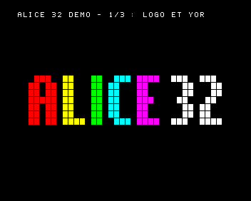
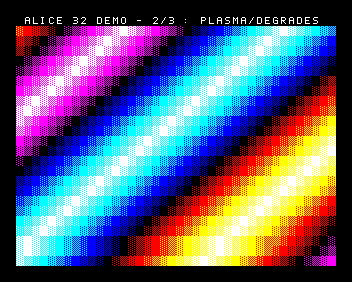
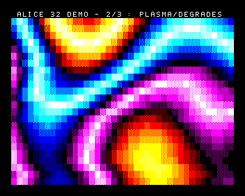
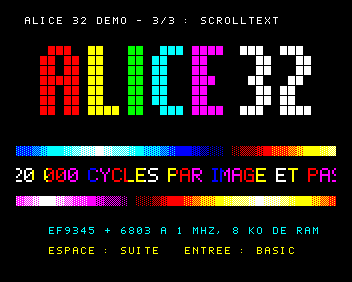
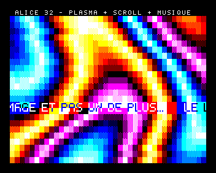
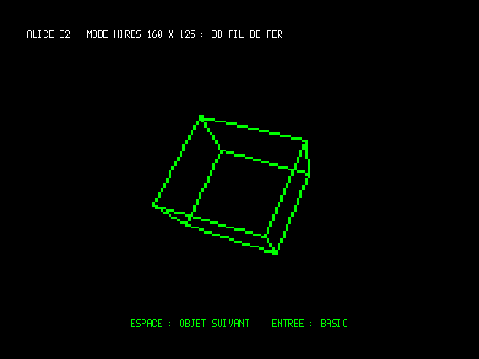
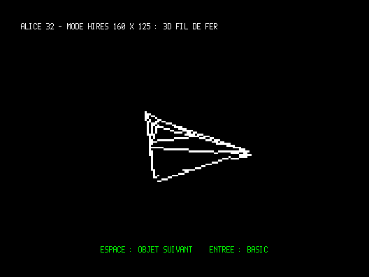

# Démo Alice 32 et programmes de test

Exemple **original** du dépôt. Une démo en assembleur 6803 (syntaxe DASM) en trois parties, avec une musique jouée pendant toute la démo, et un programme de test par technique. Les idées viennent de [`docs/13-programmation-jeux.md` §10](../../docs/13-programmation-jeux.md#10-pistes-pour-des-démos-demomaking-c-toutes-à-tester).

> **Statut [C]** : aucun de ces programmes n'a tourné sur une vraie Alice, ni sous DCAlice ou MAME. Ils ont seulement été exécutés dans `outils/simulateur.py`, un simulateur **simplifié** (6803 + petit modèle de l'EF9345, voir plus bas). Ce simulateur vérifie la logique (adresses, boucles, tables, touches, notes), pas la fidélité de l'EF9345. Les captures ci-dessous en viennent.

| Logo + YOR | Dégradé | Plasma | Scrolltext |
|---|---|---|---|
|  |  |  |  |

## Les programmes

Tous se chargent à **`$3400`** et se lancent par **`EXEC 13312`**. Ils tiennent dans les 8 Ko de la machine de base (aucune extension mémoire nécessaire).

| Programme | Contenu | Binaire | RAM utilisée |
|---|---|---|---|
| `demo` | les trois parties à la suite, en boucle (≈ 100 s), **avec musique** | 5 632 o | `$3400-$4D63` |
| `demo2-plasma-scroll` | **effets combinés** : plasma plein écran, scrolltext par-dessus, musique | 4 864 o | `$3400-$4A63` |
| `demo3-vectoriel` | **3D fil de fer** en mode HIRES 160 × 125 (80 colonnes mosaïque) : cube, puis vaisseau | 2 816 o | `$3400-$4D1F` |
| `test1-logo` | logo « ALICE 32 » en tuiles, défilement vertical fluide par YOR | 2 048 o | `$3400-$3ED7` |
| `test2-plasma` | dégradé diagonal (4 s) puis plasma (12 s) | 1 792 o | `$3400-$3DD7` |
| `test3-scroll` | scrolltext au point près, double hauteur + double largeur | 4 352 o | `$3400-$4863` |
| `test3b-scroll-simple` | le même en taille normale (si le double s'affiche mal) | 4 352 o | `$3400-$48EF` |
| `test4-musique` | la mélodie seule ; la marge change de couleur à chaque note, deux barres continuent de défiler | 1 792 o | `$3400-$3DD7` |

Touches (lecture directe de la matrice, avec anti-rebond) : **ESPACE** = partie suivante (ou recommencer dans un test), **ENTRÉE** = retour au BASIC (interruptions coupées, écran réinitialisé par `INASS`). Sinon, RESET.

## Charger dans un émulateur

Les fichiers prêts à charger sont dans `build/` : `.k7` (cassette) et `.bin` (binaire brut à `$3400`).

**DCAlice** : *Fichier → charger cassette* → `build/demo.k7`, puis taper :

```
CLOADM
EXEC 13312
```

**MAME** (pilote `alice32`, comme pour *Tuiles curieuses*, voir `docs/10` §5.2) :

```bash
mame alice32 -cass build/demo.k7
```

ou avec un `.wav` fabriqué par `./construire.sh wav` (≈ 1 Mo par programme).

Taper ensuite `CLOADM`, lancer la cassette (menu de l'interface de MAME), puis `EXEC 13312`.

**Le format `.k7`/`.wav` est déduit** du format cassette Microsoft/MC-10 (`outils/bin2k7.py`, [C]). Si le chargement échoue, charger le `.bin` à `$3400` avec le débogueur de l'émulateur, puis taper `EXEC 13312`.

## Ce qu'il faut observer (et me signaler)

| Partie | Résultat attendu | En cas de problème, suspecter |
|---|---|---|
| 1. Logo | le logo monte du bas jusqu'au milieu (pause 2 s), sort en haut, revient du haut au milieu (pause), sort en bas, **un point par image**, sans saut de 10 points | saut ou tremblement au changement de rangée : moment où ROR est pris en compte (question V2) ; rien ne bouge : bit 2 de R0 (VSYNC), le délai de garde de 45 ms ralentit alors tout |
| 2a. Dégradé | bandes diagonales de couleurs qui défilent, avec des trames 25/50/75 % | couleurs fausses : ordre des bits de l'attribut A ; pas de trame : tuiles G'0 (bloc 3, DOR = `$13`) |
| 2b. Plasma | taches de couleurs ondulantes, environ 20 images/s | — |
| 3. Scrolltext | texte en gros caractères (16 × 20 points) qui avance de 4 points par image, couleurs qui tournent, deux barres de dégradé | caractères coupés en deux ou dédoublés : double largeur/hauteur → essayer `test3b-scroll-simple` ; texte haché : incrémentation de X par OCT |
| Musique | mélodie en la mineur (≈ 17 s, en boucle) pendant toute la démo, sans ralentir l'image | aucun son : interruption OCF ou trampoline `$3206` ; son « sale » : partage de `$BFFF` avec le clavier |
| Clavier | ESPACE passe à la partie suivante ; ENTRÉE rend la main au BASIC | parties qui défilent toutes seules : lecture du clavier perturbée par le son (question E2) |

## Comment c'est fait

### 1. Logo : carte de tuiles + YOR (doc 13 §3.4, §3.7)

- Le logo est une carte de 7 rangées × 40 cases : une case vaut 0 (vide) ou une couleur. Une case pleine est une tuile de **7 × 9 points** (effet « grille de LED »).
- La rangée de carte *m* est rangée dans la rangée mémoire **Y = 8 + (m mod 24)**. Avec **YOR = Y(pos)**, monter d'une rangée demande seulement d'écrire **ROR** et **la rangée qui entre** (40 KRF) : rien n'est recopié.
- Le **décalage fin de 0 à 9 points** est obtenu en redéfinissant **3 tuiles** à chaque image : chaque case est codée par la paire *(sa case, la case du dessous)*, à savoir plein/plein, plein/vide ou vide/plein, et la tuile affiche les lignes *p* à *p* + 9 de cette paire. On envoie 40 octets par **OCT avec incrémentation** dans le tampon des codes 0-3 de G'0.
- Coût mesuré dans le simulateur : 2 ms par image (6 ms au plus, quand une rangée entre).

### 2. Plasma et dégradés (doc 13 §10)

- 4 tuiles de **trame** (0, 25, 50, 75 %) et 2 couleurs par case donnent une **palette de 64 teintes** (16 couples de couleurs × 4 trames), rangée dans deux tables de 256 octets alignées (`TABC` : code, `TABA` : attribut) calculées au démarrage.
- Plasma : `v(x, y) = AX[x + d(y)] + BY(y)` (sommes de sinus recalculées à chaque image, plus un décalage par rangée pour onduler) ; chaque case coûte **≈ 41 cycles** grâce à du code **auto-modifié** (l'octet faible de `ldaa TABC` reçoit `v`) et à 8 cases déroulées par boucle. 960 cases ≈ 49 ms : **≈ 20 images/s**.

### 3. Scrolltext (doc 13 §10)

- Une rangée de **20 caractères redéfinis** consécutifs (codes 64-83), affichés en **double hauteur + double largeur** (octet B = `$8A`, chaque code répété sur 2 colonnes et 2 rangées).
- Les 7 lignes de ces 20 tuiles sont gardées en RAM. À chaque point, chaque ligne est décalée par une chaîne de `ROR` (de droite à gauche, le bit 0 étant le point de gauche) et la colonne suivante du caractère courant entre par la retenue. Police 5 × 7 originale, à chasse variable.
- Envoi : 5 tampons × 28 octets par OCT avec incrémentation (X = 4 × tranche + code & 3). Coût total : **12,5 ms par image**, couleurs et barres comprises.
- Texte : **1 241 caractères** (`outils/gen_donnees.py`). Il occupe l'essentiel de la RAM restante de la démo : il reste ≈ 150 octets avant `$4E00`. Le programme refuse de s'assembler s'il déborde.

### 4. Combinaison plasma + scrolltext + musique (`demo2-plasma-scroll`)



- Le plasma entier coûte ≈ 49 ms, plus qu'une image ; le scrolltext doit être renvoyé à **chaque** image pour rester fluide. À chaque image on fait donc d'abord le scrolltext (≈ 5 ms), puis le plasma **par tranches de rangées** tant que le compteur du timer (`$09`, 1 µs) indique qu'il reste du temps : une rangée est commencée seulement avant 15,5 ms, le calcul des tables (`P_CALC`) seulement avant 13 ms (`inc/partie-combo.inc`). Le programme s'adapte ainsi à la vitesse réelle de la machine.
- Résultat dans le simulateur : **aucune image perdue** (les 500 images de 10 s espacées de 20 ms), texte à 50 images/s, plasma à ≈ 10 images/s (≈ 4,6 rangées par image).
- Les deux rangées du texte font partie du plasma : chaque case garde son code de tuile de texte, prend pour fond la couleur du plasma à cet endroit, et une couleur de texte qui contraste (table `CONTR`).
- Si l'image saute sur la vraie machine (commandes plus lentes que dans le simulateur), baisser `C_LIM_RANG` et `C_LIM_CALC`.

### 5. 3D fil de fer en 160 × 125 (`demo3-vectoriel`)

| Cube (vert) | Vaisseau (blanc) |
|---|---|
|  |  |

- **Mode** : 80 colonnes ; une cellule de 6 × 10 pixels dont le code C a le bit 7 à 1 est une **mosaïque** de 10 sous-blocs de 3 × 2 pixels. Cela donne 160 × 125 points presque carrés sur un téléviseur 4:3, en deux couleurs pour tout l'écran (DOR) ; le fond prend la couleur de la marge. Les bits de la mosaïque et l'adressage par KRL viennent de l'émulation EF9345 de MAME (`docs/04` §8.1, source S25).
- **Méthode** :
  - une copie en RAM de la fenêtre de 128 × 100 points, soit 64 cellules × 20 rangées à 2 octets par cellule ;
  - à chaque image, on efface en RAM les cellules de l'image précédente, puis on trace les arêtes avec un Bresenham au point près, en notant chaque cellule nouvellement touchée ;
  - on envoie ensuite chaque cellule concernée **une seule fois**, avec son contenu final : les traits ne clignotent pas.
- **3D** : trois rotations par des multiplications signées 8 × 8 (instruction `MUL`), et une perspective par une table 1/z (`donnees-persp.inc`). Les objets sont décrits en tête de `inc/vecteur.inc` : sommets, arêtes, couleur, vitesses de rotation. On peut en ajouter, dans un rayon de 60.
- **Mesures dans le simulateur** :
  - **≈ 10 images/s** ;
  - environ 330 points et 300 cellules envoyées par image ;
  - à chaque image, l'écran est resté identique à la copie en RAM sur 327 images, changements d'objet compris.
- Le cube et le vaisseau alternent toutes les 12 s ; ESPACE change d'objet. ENTRÉE rend la main au BASIC, en 40 colonnes.
- **Ce n'est pas une Vectrex** : la Vectrex trace des traits continus au faisceau. Ici les traits sont faits de gros points. On retrouve l'esprit (fil de fer lumineux sur fond noir), pas la finesse.

### Musique non bloquante (doc 05 §2 et §4, doc 13 §5)

- **OCF** (trampoline `$3206`) : à chaque échéance on inverse le bit 7 de `$BFFF` et on ajoute la demi-période de la note au registre de comparaison (`OCR += demi-période`) : la hauteur est exacte quelle que soit la latence (A4 mesuré à 439,4 Hz dans le simulateur). Coût ≈ 60 cycles par inversion, soit 5 % du processeur à 440 Hz.
- **TOF** (trampoline `$3203`, toutes les 65,5 ms) : compteur `TICKS` (sert aussi à minuter le plasma) et un pas de partition. Une croche = 2 pas = 131 ms ; le dernier pas des notes longues est muet (articulation).
- La mélodie (originale, la mineur, 16 mesures) est dans `outils/gen_donnees.py`, en notation `A4:2 C5:2…`.

## Réglages

Dans l'en-tête de `demo.asm` ou des tests :

| Constante | Effet |
|---|---|
| `AVEC_MUSIQUE` | 1 = musique sous interruptions ; 0 = seulement l'horloge TOF |
| `S_DBL` | 1 = scrolltext en double taille (20 tuiles) ; 0 = taille normale (40 tuiles) |
| `VITESSE` | points de tuile parcourus par image (2 = 4 points d'écran en double largeur) |

Le texte, la mélodie, le logo et la police se modifient dans `outils/gen_donnees.py` ; relancer `./construire.sh`.

## Construire

```bash
./construire.sh
```

Ce script régénère `inc/donnees-*.inc`, assemble chaque programme avec **DASM** s'il est installé (`dasm prog.asm -f3 -obuild/prog.bin`), sinon avec `outils/asm6803.py`, et fabrique les `.k7`. Option `wav` pour les `.wav`.
`outils/asm6803.py` est un petit assembleur 6803 qui accepte le sous-ensemble de la syntaxe DASM employé ici. Il donne pour `exemples/squelette-jeu.asm` les mêmes 172 octets que DASM ; les binaires de la démo n'ont pas été comparés avec DASM.

### Simulateur

```bash
python3 outils/simulateur.py build/demo.bin --png capture --a 3,20 --touche 5:ESPACE --son demo.wav
```

Il produit des captures PNG aux instants demandés (en secondes), simule des appuis de touches et enregistre le son. **Ce qu'il ne reproduit pas** : les suspensions de commandes de l'EF9345 pendant l'affichage, les vraies durées des commandes, la police de la ROM (G0 est dessiné avec la police de la démo), le clignotement, l'instant exact où ROR est pris en compte. Il prouve que le programme est cohérent, pas qu'il marche sur la machine.

## Fichiers

| Fichier | Rôle |
|---|---|
| `demo.asm`, `test*.asm` | programmes principaux (quelques lignes chacun) |
| `inc/commun.inc` | constantes, EF9345 (attente, IND, CLF, texte, caractères redéfinis, OCT), palette, clavier, horloge, démarrage et retour au BASIC |
| `inc/musique.inc` | interruptions OCF/TOF, lecteur de partition |
| `inc/partie-logo.inc`, `partie-plasma.inc`, `partie-scroll.inc` | les trois parties |
| `inc/vecteur.inc` | 3D fil de fer en 160 × 125 : copie d'écran, tracé de segments, rotations, envoi par KRL, objets (`demo3-vectoriel`) |
| `inc/partie-combo.inc` | plasma + scrolltext dans la même image (`demo2-plasma-scroll`) |
| `inc/fin.inc` | table de sinus alignée, zones de travail, contrôle de la taille |
| `inc/donnees-*.inc` | **générés** par `outils/gen_donnees.py` |
| `outils/` | générateur de données, assembleur, simulateur, `bin2k7.py` |
| `build/` | binaires `.bin` et cassettes `.k7` |
| `captures/` | captures du simulateur |

## Questions que ces tests peuvent trancher

En lien avec [`docs/12-questions-ouvertes.md`](../../docs/12-questions-ouvertes.md) : **V9** (mosaïque 80 colonnes, avec `demo3-vectoriel`), **V2** (changement de ROR et défilement fin), **V3** (fenêtre de retour de trame, bit 2 de R0), **V1** (débit de KRF/OCT, via la fluidité du plasma et du scrolltext), **E2/E4/E5** (son sous interruptions, partage clavier/son), ainsi que l'incrémentation de X par OCT dans un tampon de caractères redéfinis et la double hauteur + double largeur sur des caractères de G'0.
